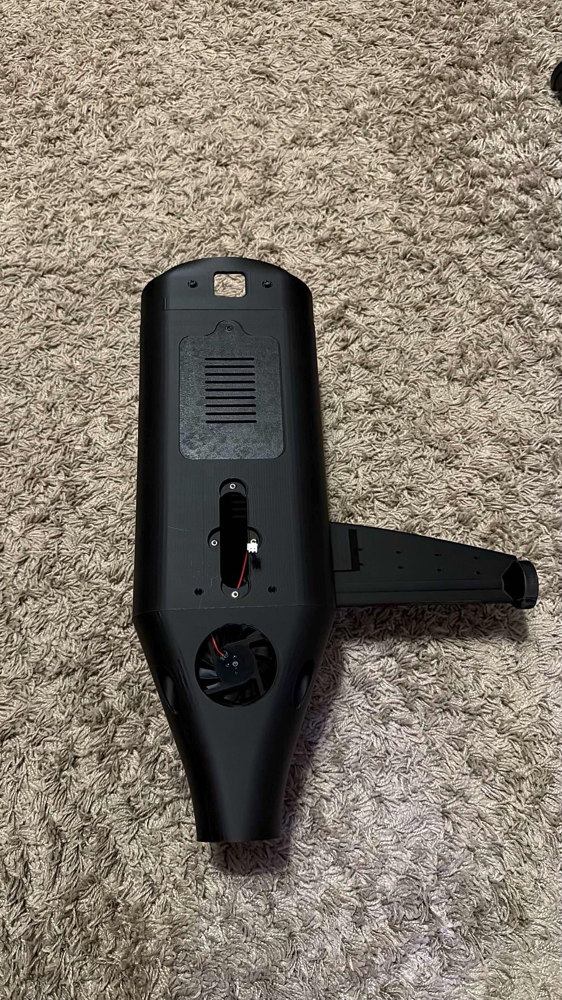
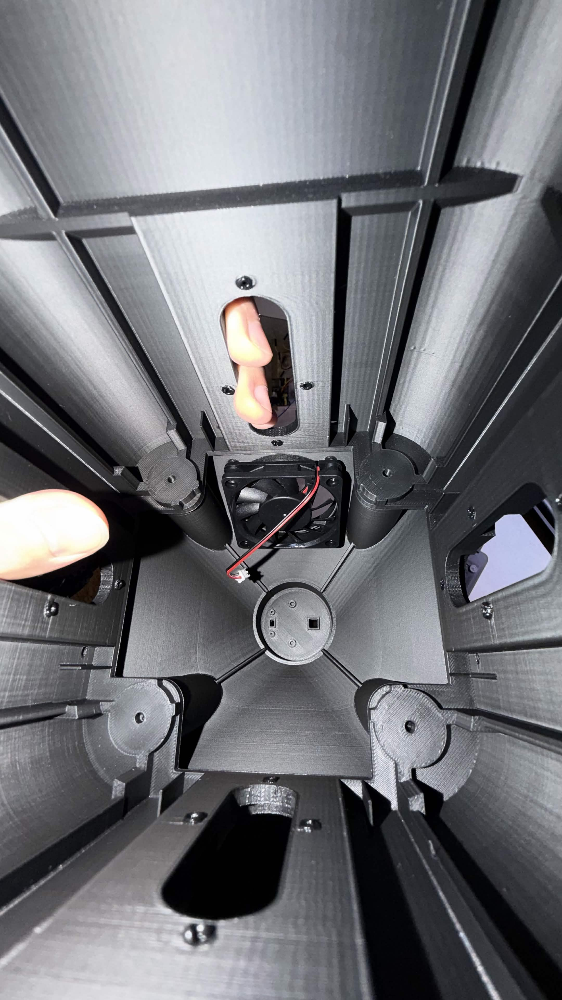
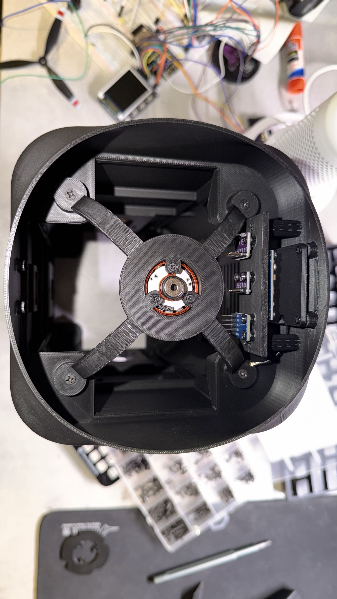

# Mechanical Design

## Overview

Mechanical development of a custom thrust-vectoring
tail-sitter VTOL UAV, designed using Autodesk Fusion 360.

## Prototype Development Progress

### 1. Fuselage Exterior

Custom 3D-printed fuselage featuring integrated
ventilation and mounting points.

### 2. Internal Structure

Internal structural reinforcements and electronics
mounting provisions.

### 4. Drone Assembly Progress

Progress on camera's gimbal assembly

## Development Status

- [x] Initial fuselage CAD design
- [x] Fuselage 3D printing
- [x] Internal mounting structures
- [x] Cooling system installation
- [x] Camera gimbal assembly
- [ ] Complete propulsion arm integration
- [ ] Thrust-vectoring mechanism testing
- [ ] Structural testing
- [ ] Flight testing
